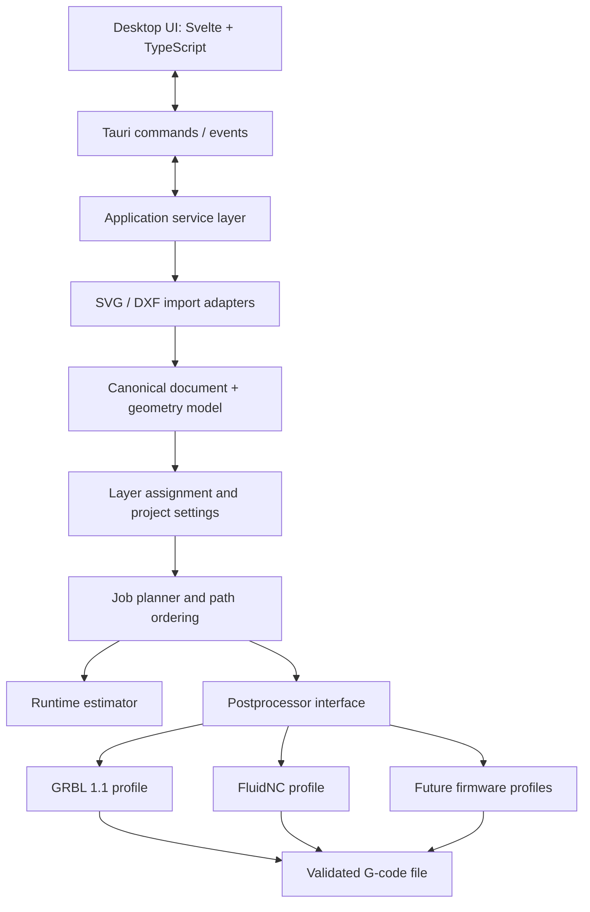

# Rust Laser CAM: Architecture and Build Plan

**Status:** Proposed technical plan  
**First target:** Linux desktop  
**Suggested application stack:** Rust + Tauri 2 + Svelte/TypeScript  
**Primary deliverable:** A vector-first laser CAM application that imports SVG/DXF, assigns paths to ordered process layers, previews the job, estimates runtime, and exports firmware-profiled G-code.

---

## 1. Executive summary

Build a small, cross-platform desktop application inspired by the *workflow* of LaserGRBL, but focused first on **vector preparation and predictable G-code generation** rather than machine control or raster engraving. Use Rust for document import, geometry normalization, job planning, G-code post-processing, and estimation. Use Tauri as the native desktop wrapper and a web frontend for the user interface.

The most important architectural decision is to keep the CAM engine **independent of Tauri and the frontend**. The engine should be usable in unit tests and, later, from a command-line interface or another GUI. Tauri should mostly handle application lifecycle, native file dialogs, permissions, and communication with the Rust engine.

Start with SVG and a practical subset of DXF, a 2D vector preview, editable processing layers, a GRBL 1.1-oriented G-code profile, a conservative time estimate, and a no-laser frame operation. Add more firmware dialects only when each profile has documented capabilities and regression tests.

> **Important scope note:** “All open-source laser firmware” is a long-term compatibility goal, not something to promise in the first release. Firmware projects can differ in supported G-code, laser power semantics, motion modes, and configuration. Treat compatibility as a growing set of explicit, testable profiles.

## 2. Product goals and non-goals

### Goals for the first usable release

- Import SVG and DXF vector files, detect units where possible, and preview the imported geometry.
- Preserve individual path/object identity and useful source metadata, such as source color, SVG element ID, DXF layer, and entity type.
- Select objects manually or assign them through color filtering.
- Convert objects into processing layers with a stable order, per-layer speed and power, visibility, and export enablement.
- Display a coordinate grid, origin, scale, extents, rulers, and job bounds.
- Generate a frame/bounds operation that moves around the job extents with the laser explicitly disabled.
- Export deterministic G-code for a defined firmware profile.
- Estimate time from path lengths, feed rates, travel moves, and pass counts, while clearly indicating estimation uncertainty.
- Save and reopen editable projects without depending on the original source file still being available.
- Run offline and build first on Linux, without making the core engine Linux-specific.

### Explicit non-goals for the MVP

- Raster/photo engraving, dithering, and bitmap-to-vector conversion.
- USB/serial streaming, jogging, machine settings management, realtime overrides, and controller dashboards.
- Automatic nesting, kerf compensation, path offsets, tabs, lead-ins/lead-outs, hatch fills, and advanced path optimization.
- Claiming universal support for every firmware merely because it accepts some G-code.
- Modifying the user's source SVG/DXF in place.

These can be added later, after import, coordinate handling, and G-code generation are reliable.

## 3. Product reference and licensing boundaries

LaserGRBL is a useful reference for laser-oriented workflows: G-code preview, vector import, job-time preview, and controls for GRBL machines are part of its published feature set. Its repository describes it as a Windows-oriented C# application, and its license file identifies GPL-3.0-or-later licensing. References: [LaserGRBL repository and feature list](https://github.com/arkypita/LaserGRBL) and [LaserGRBL license](https://github.com/arkypita/LaserGRBL/blob/master/LICENSE.md).

Use it as a **product/workflow reference**, not as a code, asset, or UI-template source. Design your own data model and implementation, and track the licenses of all Rust crates and bundled assets. If you intend to copy or adapt code from LaserGRBL, treat that as a separate licensing decision and review GPL obligations with qualified counsel. This document is an engineering plan, not legal advice.

## 4. Recommended technology choices

| Concern | Proposed choice | Why / caveat |
|---|---|---|
| Desktop shell | [Tauri 2](https://v2.tauri.app/start/) | Small native wrapper; Rust backend; Linux first with room for Windows/macOS later. |
| Frontend | Svelte + TypeScript + Vite | Compact interface, typed IPC payloads, quick iteration. React or Vue would also work; choose one and avoid mixing frameworks. |
| Geometry and G-code | Rust workspace/library crates | Testable without launching the UI; shared by desktop and eventual CLI. |
| SVG parsing | [`usvg`](https://docs.rs/usvg/latest/usvg/) | Resolves many SVG details, including CSS, transforms, references, and basic-shape conversion into paths. Validate its supported SVG subset against fixtures. |
| DXF parsing | [`dxf`](https://docs.rs/dxf/latest/dxf/) initially | Rust crate capable of reading DXF/DXB and exposing entities. Wrap it behind an importer interface so it can be replaced if a format limitation appears. Evaluate alternatives against a fixture corpus before committing. |
| Preview | Canvas 2D in the web frontend, with an optional SVG overlay for selections | Efficiently draws many objects; keeps pan/zoom and grid responsive. Consider WebGL only if profiling proves it necessary. |
| Project storage | Versioned JSON project format initially | Human-inspectable and easy to migrate. A zipped project bundle can follow if embedding source assets becomes useful. |
| File dialogs | Official Tauri dialog plugin | Use native open/save dialogs. Do not grant the frontend broad filesystem access unnecessarily. |
| Errors | Typed Rust errors converted to stable frontend error objects | Avoid leaking implementation details or returning unstructured strings for routine failures. |
| Tests | Rust unit/integration tests + frontend tests + golden G-code fixtures | Validate geometry and emitted G-code separately from the UI. |

Tauri documents typed frontend-to-Rust command calls in its [command/IPC guide](https://v2.tauri.app/develop/calling-rust/), and native file dialogs in its [dialog plugin guide](https://v2.tauri.app/plugin/dialog/). SVG parsing is non-trivial; the `usvg` documentation describes its normalized tree and supported path representation. See the [usvg documentation](https://docs.rs/usvg/latest/usvg/). The [`dxf` crate documentation](https://docs.rs/dxf/latest/dxf/) demonstrates entity access and file parsing.

## 5. High-level architecture

Keep a strict boundary between **document geometry**, **manufacturing intent**, and **firmware-specific output**.



### Layer responsibilities

1. **Frontend UI:** display and edit state; draw geometry, grid, selection, and bounds; collect settings; show warnings and estimates. Do not implement a second independent geometry or G-code engine in TypeScript.
2. **Tauri shell:** windowing, native open/save dialogs, application settings location, narrowly scoped permissions, and event delivery.
3. **Application service layer:** orchestrate import, project edits, previews, estimation, saving, and export. This is the only layer that needs to know about Tauri command handlers.
4. **Import adapters:** parse SVG or DXF and translate the result into the canonical model. Each adapter reports warnings for unsupported entities or ambiguous units.
5. **Canonical geometry/project model:** store vector geometry in millimetres, object identity, source metadata, layers, machine/job settings, and transformations.
6. **Planner:** decide which paths run, in what order, at what speed/power/pass count, and how to insert safe travel motions.
7. **Firmware postprocessor:** turn a planned job into a specific G-code dialect, using explicit capabilities and settings rather than scattered `if firmware == ...` conditions.
8. **Estimator/validator:** calculate an approximate runtime and check output invariants before export.

### Suggested repository layout

Start with a Cargo workspace. Avoid splitting every module into a separate crate on day one; use the following logical boundaries, and split into separate crates where independent testing or dependencies justify it.

```text
laser-cam/
├── Cargo.toml                    # workspace
├── package.json                  # frontend scripts
├── src/                          # Svelte/TypeScript UI
│   ├── lib/components/
│   ├── lib/stores/
│   ├── lib/api.ts                 # typed Tauri API wrapper
│   └── routes/                    # or application views
├── src-tauri/
│   ├── Cargo.toml
│   ├── tauri.conf.json
│   ├── capabilities/
│   └── src/
│       ├── main.rs
│       ├── lib.rs
│       ├── commands.rs
│       └── app_state.rs
├── crates/
│   ├── laser-core/                # document, units, geometry, transforms, errors
│   ├── laser-import/              # importer trait and orchestration
│   ├── laser-import-svg/          # usvg adapter
│   ├── laser-import-dxf/          # dxf adapter
│   ├── laser-planner/             # layer-to-motion plan
│   ├── laser-gcode/               # common motion IR and postprocessor interface
│   ├── laser-profile-grbl/        # GRBL 1.1 implementation
│   └── laser-estimator/           # timing and report
├── fixtures/
│   ├── svg/
│   ├── dxf/
│   └── expected-gcode/
├── docs/
│   ├── firmware-profiles.md
│   ├── supported-formats.md
│   └── project-format.md
└── tests/
```

An early prototype can keep the modules inside one Rust crate. The non-negotiable rule is the dependency direction: core geometry must not depend on Tauri or the frontend.

## 6. Canonical coordinate and geometry model

### 6.1 Use millimetres internally

Represent all canonical coordinates and feed rates in **millimetres** and **millimetres per minute**. Convert at import boundaries and only convert to the target firmware's units at G-code emission if the profile requires it.

Keep source details for traceability:

- Source format and file name.
- Original units, or `unknown` if not inferable.
- Source object ID, source color, DXF layer name, and original entity type.
- Import warnings and any approximations performed.
- The transform from source coordinates to canonical coordinates.

Never silently assume that a unitless file has physical dimensions. Ask the user to select a unit or calibrate a known dimension; remember that choice in the project.

### 6.2 SVG unit handling

- Honor physical width/height units when present (mm, cm, in, pt, pc, and CSS px where supported).
- Interpret CSS pixels according to the SVG/CSS convention used by the parser (commonly 96 px per inch), converting to mm at import.
- Use `viewBox` and viewport dimensions together to calculate the document transform.
- If only a viewBox/user-unit coordinate space exists and physical dimensions are absent, flag the scale as ambiguous and offer a unit/calibration prompt.
- Apply nested transforms, groups, and supported CSS/inherited styles before creating canonical geometry.
- Do not infer cut semantics solely from `fill`: keep stroke/fill style metadata, but treat closed fill regions as boundary outlines in the MVP. Explain that filled shapes are not automatically hatched.

### 6.3 DXF unit handling

- Read the drawing's `$INSUNITS` and related available metadata.
- If the unit metadata is missing, unsupported, or inconsistent with its extent, ask the user to confirm units before G-code export.
- Support model-space geometry first. Add recursive block/insert transforms with tests before claiming broad DXF compatibility.
- Preserve DXF layer names and entity colors. Respect entity-level colors where present and define how “ByLayer” and “ByBlock” colors are resolved.
- Do not silently ignore entities that cannot be represented. Return a useful import report listing imported, approximated, and skipped entity counts.

### 6.4 Geometry representation

Retain curves for as long as practical. A reasonable canonical path representation is:

```rust
struct VectorDocument {
    id: DocumentId,
    units: UnitMetadata,
    bounds_mm: Bounds2D,
    objects: Vec<PathObject>,
    import_warnings: Vec<ImportWarning>,
}

struct PathObject {
    id: ObjectId,
    geometry: PathGeometry,
    style: SourceStyle,
    source: SourceMetadata,
    layer_id: Option<LayerId>,
    visible: bool,
    export_enabled: bool,
}

struct PathGeometry {
    subpaths: Vec<Subpath>,
}

struct Subpath {
    start: PointMm,
    segments: Vec<PathSegment>,
    closed: bool,
}
```

`PathSegment` should at least represent line, quadratic Bézier, cubic Bézier, and circular arc geometry. If a parser normalizes an SVG arc into cubic segments, that's acceptable as long as shape and tolerance are tested. For G-code profiles that support arcs, an arc-preserving path can later emit `G2/G3`; for the MVP, flatten curves to line segments using a configurable chord-error tolerance in mm. Keep original curve geometry separate from the flattened preview/planning cache.

Use `f64` for geometry calculations. Validate against NaN, infinity, and unreasonably large extents on import. Introduce a spatial index only if selection or hit-testing performance requires it.

### 6.5 Coordinate transforms and origin

Keep source coordinates and machine/job coordinates conceptually separate:

- Source/document coordinates: from SVG/DXF.
- Canonical physical coordinates: millimetres, normalized through import.
- Job transform: scale/translate/rotate and chosen job origin.
- Machine coordinates: only relevant if machine dimensions and a work offset are configured.
- Screen coordinates: frontend-only pan/zoom and canvas transform.

Implement explicit commands for “fit to view,” “center job,” “place lower-left at origin,” and “place center at origin.” A Y-axis flip between SVG-style screen coordinates and machine-style Cartesian coordinates should happen in a documented transform, not as ad hoc negation spread throughout the code. The preview must show the same transformed bounds that the exporter will use.

## 7. Layer model and user workflow

A processing layer represents **what operation to run and how to run it**, not just a color.

Proposed layer settings:

```rust
struct ProcessLayer {
    id: LayerId,
    name: String,
    display_color: Rgba8,
    order: u32,
    visible: bool,
    export_enabled: bool,
    operation: OperationKind, // e.g. cut, engrave-line, frame, travel-only
    speed_mm_min: f64,
    power_percent: f64,
    passes: u32,
    laser_mode: LaserMode,    // constant or dynamic, if supported
    source_assignment: AssignmentRule,
}
```

Keep `visible` separate from `export_enabled`: a user can hide a layer to inspect the design without accidentally disabling its export. Hidden layers should remain in the project. The UI must make it obvious which layers will be exported.

### 7.1 Color presets and automatic assignment

Begin with a documented standard palette, for example:

| Preset | Color | Suggested default use (customizable) |
|---|---|---|
| Red | `#FF0000` | Cut |
| Green | `#00FF00` | Engrave |
| Blue | `#0000FF` | Mark/engrave |
| Yellow | `#FFFF00` | Secondary operation |
| Magenta | `#FF00FF` | Special operation |
| Cyan | `#00FFFF` | Special operation |
| Black | `#000000` | Unassigned/engrave candidate |
| White | `#FFFFFF` | Unassigned/disabled candidate |

These are **application presets**, not machine standards. Users must be able to rename them, change their colors, and change each layer's process settings.

Automatic assignment should:

1. Extract the source stroke color, falling back to fill color only when there is no usable stroke, while preserving both styles.
2. Resolve inherited SVG styles and DXF ByLayer colors in the importer.
3. Match source color to a preset using a configurable tolerance. Start with a simple, documented color-distance rule; consider perceptual Lab/Delta-E matching later if users need it.
4. Put unmatched colors in an “Unassigned” group rather than silently merging them into a layer.
5. Show the user a preview/count for each match before applying it.
6. Allow explicit manual assignment to override automatic matching.

### 7.2 Manual assignment and selection

Support these interactions in order of priority:

1. Click to select one path/object; Shift-click to add/remove from selection.
2. Rectangle/lasso selection if it is easy to implement with the preview renderer.
3. “Select all objects with this source color.”
4. “Assign selected objects to layer.”
5. “Create layer from selection.”
6. Layer reorder by drag-and-drop; stable order must be persisted and reflected in generated G-code.

For path-centric operation, define whether multiple SVG subpaths inside a single element are one selectable object or separate selectable paths. Preserve the parent/source relationship even when subpaths are split for selection or assignment.

### 7.3 Layer ordering and path ordering

MVP behavior should be predictable rather than clever:

- Run enabled layers in the explicit user-defined order.
- Within a layer, preserve a stable imported order (with a deterministic tie-breaker by object ID).
- Move between path starts with the laser off.
- Do not silently reorder cut and engraving layers.
- Add optional nearest-neighbor path optimization later as an explicit user action, with a before/after estimate and reversible result.

Closed-path start-point rotation and reverse-direction optimization are later improvements because they can change cut order and quality.

## 8. Preview UI design

Aim for a simple workbench with four areas:

1. **Top toolbar:** Open, Save Project, Undo/Redo (when available), Fit, grid toggle, unit/scale status, Generate/Export G-code.
2. **Main canvas:** vector geometry, pan/zoom, selection, coordinate grid, origin axes, rulers, job extents, and optional machine workspace outline.
3. **Layer panel:** color swatch, name, visibility, export-enabled toggle, order, and object count.
4. **Properties panel:** speed, power, pass count, operation type, laser mode, assignment rule, and selected-object metadata.
5. **Bottom/status area:** document dimensions, selected object count, layer count, total path length, predicted time, warnings, and firmware profile.

### Canvas behavior

- Fit-to-view must use the same computed geometry bounds as job planning.
- Grid spacing should adapt to zoom (for example 1, 5, 10, or 50 mm) and be configurable. Grid is visual by default; snap-to-grid should be a separate option and must not alter imported geometry unless explicitly requested.
- Show origin, positive X/Y directions, scale, width/height, and a clear distinction between document bounds and machine work area.
- The selection highlight should be visually distinct from the layer color.
- Hidden layers are not drawn; non-exported-but-visible layers remain visible and should use a distinct indicator.
- On import, display a report for unsupported objects, ambiguous units, colors that didn't match, and path simplifications.

For the first version, render each object as a canonical polyline or path on one Canvas 2D context. Implement screen-to-world mapping and hit testing carefully. If rendering selection becomes cumbersome, use a lightweight SVG overlay only for selection handles/outlines. Avoid sending full geometry through IPC on every small UI action; keep stable project geometry in Rust and send preview geometry/metadata when needed, with incremental updates for simple layer-property changes.

## 9. G-code architecture and firmware profiles

### 9.1 Don't encode firmware assumptions in the planner

The planner should produce a firmware-neutral **motion plan**. The postprocessor turns that plan into actual lines using a firmware profile. Example motion-plan instructions:

- `RapidTo(point)`
- `LaserMoveTo(point, feed, power)`
- `LaserOffMoveTo(point, feed)`
- `SetLaser(power, mode)` if required by the target dialect
- `Dwell(duration)` only if a future operation requires it
- `ProgramEnd`

The postprocessor owns syntax, modal state, startup/shutdown commands, power mapping, and dialect-specific differences.

### 9.2 Firmware profile contract

Each profile should expose versioned metadata and validated capabilities. Suggested fields:

- Profile ID, display name, tested firmware versions, and documentation URL.
- Coordinate units and whether `G20/G21` is supported.
- Absolute/relative position mode and supported coordinate precision.
- Feed-rate units and maximum/minimum configured feed rates.
- Rapid-move command and whether rapid motion guarantees laser-off.
- Laser on/off commands (`M3`, `M4`, `M5`, or profile-specific equivalents).
- Constant-power vs dynamic-power support.
- Power word/range, configured maximum power value, and mapping from percentage to the G-code `S` value.
- Whether arcs can be emitted, and supported arc plane/format when implemented.
- Header/footer, comments, line numbering/checksum needs, and optional pass behavior.
- Safety constraints and known unsupported features.

Profiles can be declarative for simple variation, but use a Rust trait or equivalent for behavior that can't be expressed safely as configuration. Validate profiles on load and refuse export when required values are missing.

### 9.3 Recommended firmware rollout

1. **GRBL 1.1:** first reference implementation and golden test suite. Support both constant power (`M3`) and dynamic power (`M4`) only when the user/profile explicitly enables an appropriate mode. Grbl laser mode uses `S` power values and documents differences between `M3` and `M4`; see the [Grbl laser-mode documentation](https://github.com/gnea/grbl/blob/master/doc/markdown/laser_mode.md) and [settings reference](https://github.com/gnea/grbl/blob/master/doc/markdown/settings.md).
2. **FluidNC:** a close follow-on with its own profile and verification. It has Grbl-compatible commands but configuration and feature behavior still need verification; consult [FluidNC commands and settings](https://github.com/bdring/FluidNC/wiki/FluidNC-Commands-and-Settings).
3. **grblHAL:** add as a separately tested profile after selecting target variants and testing their actual capabilities.
4. **Smoothieware:** add a profile with dialect-specific tests. Smoothieware documentation points out that different G-code dialects do not always assign identical meaning to commands; see its [G-code mode documentation](https://smoothieware.org/grbl-mode.html).
5. **Marlin and other open-source controllers:** add only after specifying the exact laser mode/firmware configuration and building a test matrix. “Marlin” or another project name alone is not a sufficient compatibility guarantee.

Maintain a compatibility table in `docs/firmware-profiles.md` showing: tested firmware/version, features supported, features omitted, power mapping, and hardware/test environment. Avoid saying a profile is fully compatible based on generating a file alone.

### 9.4 G-code safety invariants

- Emit a laser-off command at startup and a laser-off command at program end.
- Laser must be off during repositioning, including transitions between layers and objects.
- A frame/bounds operation must never enable the laser. Prefer a profile-supported rapid trace with explicit `M5`/laser-off state, rather than relying only on `S0`; do not emit `M3` or `M4` for the frame.
- Never assume `S1000` means 100% across all firmware. Map percent through profile values and user's machine configuration.
- Never silently change controller settings such as GRBL `$30` or `$32`; if the profile needs one, show it as a preflight requirement for the user to verify on the machine.
- Validate finite coordinates, finite positive feed rates, finite power, job bounds, and supported commands before writing the output file.
- The preview and time estimate must be generated from the same motion plan that is exported.
- If a profile cannot represent an operation safely, refuse export with a clear error instead of generating a plausible-looking file.

The [Grbl laser-mode documentation](https://github.com/gnea/grbl/blob/master/doc/markdown/laser_mode.md) explains that `M3` is constant-power mode and `M4` dynamically scales power with motion under supported configuration. It also warns that laser systems can cause permanent vision damage and fire. Therefore, include a clear preflight checklist and always verify the output with the laser disabled or in a safe test mode before actual use.

### 9.5 Suggested output shape for the initial GRBL profile

This is an illustrative pattern, **not a universally safe file**. Validate each line against the selected controller and its settings:

```gcode
; Generated by <app-name>
; Profile: GRBL 1.1
; Units: mm
G21
G90
G17
G94
M5

; Layer: Cut
G0 X10.000 Y10.000
M4 S700
G1 X40.000 Y10.000 F600
G1 X40.000 Y30.000
M5

; End of job
M5
M2
```

In the final generator, choose `M3` or `M4` based on the selected profile and layer setting, set power in a way that avoids unexpected modal transitions, and make each object's laser-off/reposition sequence explicit. Do not hard-code the example's power or feed values. The preamble shown is only a common GRBL-style starting point; test all emitted commands against the intended controller.

## 10. Planning and export pipeline

Use a deterministic pipeline:

1. Validate project and profile settings.
2. Apply the configured job transform.
3. Select objects from export-enabled layers. Visibility alone must not affect export.
4. Convert curves to line segments within a user-configurable chord-error tolerance. Keep the tolerance in physical units (mm).
5. Compute bounds and total path length per layer.
6. Expand passes in deterministic order.
7. Emit layer/path transitions and laser-off travel moves.
8. Convert layer percent power to profile `S` values.
9. Postprocess the neutral motion plan to firmware-specific G-code.
10. Run static validation over the emitted program, including modal laser state and coordinates.
11. Generate a report containing extents, length, estimated duration, layer statistics, selected profile, and warnings.
12. Save to a temporary file, then replace/write the final output so an error doesn't leave a half-written G-code file.

### Path direction and cut ordering

For MVP, preserve imported path direction and order. For arcs/circles, the SVG/DXF importer must normalize winding/closure without changing intended geometry. Do not automatically reverse contours until there is a clear user-facing policy for inner/outer contours, pierce order, and material behavior.

## 11. Runtime estimate design

The first estimator should be useful and transparent, not pretend to predict every machine's real-world cycle time exactly.

### 11.1 Baseline calculation

For each linear operation segment:

\[
T_{cut} = \sum_i \frac{L_i}{F_i}
\]

where `L_i` is segment length in mm and `F_i` is feed rate in mm/min, producing minutes. For rapid travel:

\[
T_{rapid} = \sum_j \frac{D_j}{F_{rapid,j}}
\]

Then add configured pass count, optional dwell, and a configurable allowance for acceleration/deceleration and command overhead:

\[
T_{estimated} = T_{cut} + T_{rapid} + T_{dwell} + T_{motion\_overhead}
\]

`F_rapid` should come from a user-configured machine profile or an explicit conservative assumption, not an invented universal default. If it's unknown, show a baseline cutting time and mark travel-inclusive total as unavailable or assumption-based.

### 11.2 Precision and honesty

- Include travel distance from the previous endpoint to each next start point.
- Include each enabled layer's pass count and any frame operation when the user asks to include it.
- Use the same flattened segments and path order as export.
- Report a duration range or confidence label when acceleration and rapid speed are not known.
- Do not present the linear model as an exact prediction: real machines have acceleration limits, cornering behavior, controller buffering, dwell settings, and other overhead.
- Add acceleration-aware estimation later using machine X/Y acceleration and motion constraints if users need a closer forecast.

### 11.3 UI estimate breakdown

Show:

- Estimated total time.
- Per-layer estimated time and path length.
- Cutting/engraving travel versus laser-off travel.
- Number of paths, segments, and passes.
- Assumptions used (units, rapid feed, acceleration allowance, curve tolerance).
- Warning if the profile/machine configuration lacks data needed for a meaningful estimate.

## 12. Frame / bounds operation

Implement “Add frame” as a generated operation derived from the bounds of the currently included geometry after the job transform. The UI should offer which bounds to use: all objects, visible objects, or export-enabled objects; default to export-enabled objects so the frame matches the generated job. Include a small optional margin in mm.

Requirements:

- Make the frame a visible, reorderable layer/operation with a `frame` operation kind and explicit `laser_must_remain_off = true` semantic (or equivalent invariant).
- Emit a rectangle around the computed extents, including margin.
- Keep the operation visually distinct in the preview.
- Use a profile-supported laser-off/rapid motion sequence and **never enable the laser in the frame sequence**.
- If the selected profile cannot guarantee a laser-off travel operation, block frame export for that profile and explain why.
- Make the user verify the physical work area and origin before using a frame; geometry extents alone do not guarantee that the machine has clearance.

## 13. Importer behavior and initial format coverage

### SVG MVP coverage

Support, test, and document the subset that the selected parser resolves correctly: paths, lines, polylines, polygons, rectangles, circles, ellipses, groups/transforms, common fill/stroke colors, and basic CSS inheritance. Include nested SVG/viewBox behavior and referenced elements only where the parser resolves them correctly.

For complex SVG features (filters, masks, clipping paths, text/fonts, unsupported external references), show a warning and either faithfully import supported geometry or refuse an ambiguous import. Do not silently pretend to support the visual appearance of an SVG if it cannot translate that appearance into a vector toolpath. Text should be converted to paths by the source application or supported by a deliberate text-to-outline feature later.

### DXF MVP coverage

Start with: `LINE`, lightweight/standard `POLYLINE`, `ARC`, `CIRCLE`, and `ELLIPSE` where the parser and conversion logic can represent them reliably. Treat `SPLINE`, `INSERT`/blocks, `HATCH`, dimensions, text, 3D entities, and paper-space content as explicit follow-on scope unless implementation and fixtures show they are safe to support in the first milestone.

Every import returns an `ImportReport` with counts by entity type, skipped/approximated items, unit certainty, total bounds, and any warnings. The UI must require confirmation when a skipped entity could materially change the job.

### Future importer contract

Design a common interface such as:

```rust
trait VectorImporter {
    fn can_import(&self, file_name: &str, sniffed_bytes: &[u8]) -> bool;
    fn import(&self, input: &[u8], options: &ImportOptions)
        -> Result<ImportResult, ImportError>;
}
```

Prefer file-byte APIs or bounded reads; add file-size limits and cancellation/progress reporting for large files. A future importer can support other path-oriented formats without changing layer logic or the planner.

## 14. Project file and state management

Use a versioned JSON project for the first release, e.g. `.lasercam.json`. Save:

- Schema version and application version.
- Canonical geometry and units metadata.
- Original source metadata and import warnings.
- Object IDs, styles, transforms, and assignments.
- Layers, order, visibility, export flags, speed/power/pass values, and operation kinds.
- Job origin/transform, display units, grid preferences, and machine/profile references.
- Last-used export profile and generation settings.

On open, validate the schema version. Use explicit migrations for changes and preserve unknown extension fields where practical. Don't rely only on absolute source-file paths to reconstruct geometry: save enough canonical geometry to reopen the job independently of the original SVG/DXF. A later zipped project bundle can preserve source assets as well.

Implement undo/redo by recording semantic commands (assign objects, modify layer, reorder layers, transform job) rather than serializing the entire project for every keystroke. Undo/redo itself can be scheduled after the main workflow if the first prototype needs to stay small, but avoid data structures that would make it impossible later.

## 15. Tauri commands and frontend/backend contract

Keep Tauri commands small and typed. Example command groups:

| Command | Responsibility |
|---|---|
| `open_vector_file` / `import_file` | Open native picker or import a chosen path; return project ID, summary, and warnings. |
| `get_project_summary` | Return bounds, units, object counts, layer summaries, and warning status. |
| `get_preview_geometry` | Return cached display geometry appropriate for preview. |
| `assign_objects_to_layer` | Update object assignments. |
| `auto_assign_by_color` | Preview or apply color matching. |
| `update_layer` | Validate and update speed, power, passes, color, visibility, and operation. |
| `reorder_layers` | Persist explicit layer order. |
| `create_frame_operation` | Compute bounds and add the frame operation. |
| `estimate_job` | Build the current plan and return estimate plus assumptions. |
| `validate_job` | Run profile, bounds, unit, and G-code safety preflight checks. |
| `export_gcode` | Generate and save the validated G-code. |
| `save_project` / `open_project` | Save or reopen a versioned project file. |

Use progress events for expensive imports/exports and cancellation where practical. Keep UI-only state (panel width, current selection, current zoom) in the frontend; keep authoritative project/geometry state and all manufacturing calculations in Rust. If sending large preview geometry over IPC becomes slow, cache a compact preview representation and update it only when geometry or job transforms change.

Treat file paths and document bytes as untrusted input. Scope Tauri capabilities to the commands and plugins actually needed. Do not expose a general shell execution API to the frontend.

## 16. Linux-first development setup

The official Tauri prerequisites page lists Linux WebKitGTK and other system dependencies. On Debian/Ubuntu, start with the current official packages and update them if the Tauri docs change:

```bash
sudo apt update
sudo apt install \
  libwebkit2gtk-4.1-dev \
  build-essential \
  curl \
  wget \
  file \
  libxdo-dev \
  libssl-dev \
  libayatana-appindicator3-dev \
  librsvg2-dev \
  pkg-config
```

Then install Rust with `rustup` using the instructions at [rustup.rs](https://rustup.rs/), and install a current Node.js LTS release if using Svelte/TypeScript. See the [official Tauri Linux prerequisites](https://v2.tauri.app/start/prerequisites/). Package names vary by Linux distribution.

### Scaffold the project

```bash
npm create tauri-app@latest
```

Choose **Svelte** and **TypeScript** in the scaffold prompts. Then enter the project directory and start the development server using the script generated by the scaffold, usually:

```bash
npm install
npm run tauri dev
```

Use the dialog plugin for open/save dialogs; the official installation guide is [Tauri Dialog](https://v2.tauri.app/plugin/dialog/). Set up the workspace and core Rust library before implementing the full UI. Do not copy a Tauri configuration file from an unrelated project: use the generated configuration for your Tauri version and then make only deliberate edits.

### Suggested development commands

At repository root, keep standard scripts or a Makefile for the tasks you run repeatedly:

```bash
# Frontend / desktop development
npm run tauri dev

# Rust formatting and static checks
cargo fmt --all -- --check
cargo clippy --workspace --all-targets --all-features -- -D warnings

# Rust test suite
cargo test --workspace

# Build optimized application bundle
npm run tauri build
```

Adjust the build command to the package scripts produced by the current Tauri scaffold. CI should run core tests without requiring a GUI wherever possible, then have a Linux build job for the desktop shell.

## 17. Implementation phases and exit criteria

### Phase 0 — Confirm scope and build a fixture corpus

**Build:** repository, workspace, error model, unit model, sample fixture directory, short compatibility matrix.  
**Tasks:**
- Capture small SVG/DXF samples with known dimensions and colors.
- Add edge cases: `viewBox`-only SVG, nested transforms, unitless DXF, circles/arcs, closed/open polylines, unsupported entities, odd colors, negative coordinates, and empty files.
- Choose first supported SVG/DXF entity subsets and write them down.
- Define the initial GRBL 1.1 output behavior and power range.

**Exit criteria:** every supported file class has a fixture and a documented expected result; ambiguous scale and unsupported geometry are surfaced as warnings/errors.

### Phase 1 — Native app shell and SVG import/preview

**Build:** Tauri desktop app that opens an SVG and displays it on a grid.  
**Tasks:**
- Create Tauri/Svelte skeleton.
- Add a typed Rust command for file import.
- Build canonical geometry and mm conversion.
- Draw the document, origin, dimensions, and bounds.
- Add fit-to-view, pan, zoom, and import warnings.

**Exit criteria:** preview geometry agrees with measured file bounds; known physical-unit fixtures import at correct scale; unknown units require an explicit decision.

### Phase 2 — DXF import and object model

**Build:** supported DXF entities appear correctly in the same preview.  
**Tasks:**
- Implement the DXF adapter.
- Import entity layer/color metadata.
- Report unsupported and approximated entities.
- Normalize transforms and units into the same canonical model.

**Exit criteria:** SVG and DXF fixtures produce comparable canonical geometry for equivalent shapes; no unsupported entity is silently lost.

### Phase 3 — Layer assignment and editing

**Build:** usable layer panel and color-driven workflow.  
**Tasks:**
- Add palette presets and configurable color tolerance.
- Preview color matching before applying it.
- Support selecting objects and assigning them to layers.
- Add layer creation, rename, reorder, visibility, export enablement, and speed/power/pass settings.
- Separate visual color from source color and toolpath settings.

**Exit criteria:** a multi-color drawing can be assigned to layers, reordered, inspected, and saved without changing its geometry unexpectedly.

### Phase 4 — GRBL 1.1 G-code generation and validation

**Build:** first reliable vector G-code export.  
**Tasks:**
- Implement the neutral motion plan.
- Implement the GRBL 1.1 profile and power mapping.
- Convert curves to line segments with a configurable error tolerance.
- Generate deterministic headers, safe travel, layer paths, and shutdown.
- Build a static checker and golden G-code tests.

**Exit criteria:** exported fixtures match approved golden output; laser state is off during travel and at program end; invalid speeds, scale, power, or unsupported operations block export.

### Phase 5 — Runtime estimate, frame, and project persistence

**Build:** end-to-end workflow usable repeatedly.  
**Tasks:**
- Add path length and per-layer estimate.
- Include travel time with disclosed rapid-speed assumptions.
- Add no-laser frame operation and margin setting.
- Save/reopen editable project JSON with schema versioning.
- Add preflight report, extents warning, and machine-work-area comparison when dimensions are known.

**Exit criteria:** reopening a project restores object/layer assignment; estimate updates when speed/order/pass settings change; frame generation never emits laser-on commands.

### Phase 6 — Compatibility expansion

**Build:** additional firmware profiles that are demonstrably tested.  
**Tasks:**
- Add FluidNC, grblHAL, and Smoothieware one at a time.
- Document each profile's tested versions and capability matrix.
- Add fixtures and static assertions for each dialect.
- Add import-format improvements based on real user files.

**Exit criteria:** each profile has reproducible test results and explicit unsupported-feature reporting; avoid advertising untested firmware support.

### Phase 7 — Packaging and portability

**Build:** repeatable Linux releases, then Windows/macOS.  
**Tasks:**
- Add CI, release versioning, dependency/license review, crash logging policy, and update strategy.
- Produce Linux bundles appropriate to the initial audience (for example, AppImage and/or distribution packages where supported by the Tauri setup).
- Validate on a clean Linux VM or second device, not just the development machine.
- Add Windows/macOS build jobs and fix platform-specific dialog, path, packaging, and WebView differences.

**Exit criteria:** a clean checkout builds with documented dependencies; releases have reproducible version tags, tests, and installation instructions.

## 18. Test strategy

### Unit tests

- Unit conversions for mm/cm/in/pt/px and DXF `$INSUNITS` mappings.
- SVG transforms, inherited style/color, nested viewBoxes, curves, and closed/open subpaths.
- DXF entity conversion, bulges, arcs/circles, layers, inserts when implemented, and missing-unit behavior.
- Bounds calculations, path length, flattening tolerance, and invalid numeric geometry.
- Color matching and stable object assignment.
- Layer order, visibility/export distinction, pass expansion, and generated frame bounds.
- Power-percent-to-`S` mapping for each profile.
- Time estimation on small geometries with analytically known lengths and travel moves.

### Golden G-code tests

For each profile, store a small project and expected G-code. Compare normalized output exactly, including line ordering and laser-on/off transitions. A change to expected output requires a deliberate fixture review.

### Static output validation

Implement an independent validator for the subset of G-code you emit. Track modal state (units, absolute/incremental mode, feed rate, laser state, power) and verify:

- Every coordinate is finite and within plausible output bounds.
- The final program ends with laser off.
- Travel does not accidentally occur in a laser-on state.
- Frame operations never enable the laser.
- Power values obey the selected profile's configured limits.
- Required mode commands precede moves that rely on them.
- Output bounds match the transformed geometry within expected flattening tolerance.

Do not validate only by comparing strings: stateful G-code should also be checked semantically.

### Integration and manual validation

- Open/import/preview/assign/reorder/export/save/reopen in the Linux app.
- Run G-code through a simulator or a firmware-compatible parser if available.
- First physical-machine tests: remove or disable the laser output where practical, raise the head safely, verify bounds and direction, and use the controller manufacturer's safe test procedure. Never assume that a syntactically valid G-code file is safe on every machine.
- Include user-reported SVG/DXF fixtures only with permission and remove private paths/metadata.

## 19. Release-readiness checklist

Before calling the first release usable:

- [ ] Unit ambiguity cannot pass silently into export.
- [ ] Preview and exported coordinates match.
- [ ] Color assignment shows unmatched source colors clearly.
- [ ] Visible and export-enabled layer states are distinct.
- [ ] Layer order is deterministic and persisted.
- [ ] Per-layer speed, power, and passes affect output and estimate.
- [ ] Frame operation guarantees laser-off output.
- [ ] GRBL power range and laser mode are explicit user settings.
- [ ] Invalid or unsupported geometry blocks export or requires an informed acknowledgement.
- [ ] Every emitted G-code profile has golden and semantic tests.
- [ ] `.lasercam.json` files reopen independently of original source files.
- [ ] Export is atomic and errors are shown clearly.
- [ ] App builds from a clean Linux environment using documented dependencies.
- [ ] License inventory and third-party notices are included in the release.

## 20. Key risks and mitigations

| Risk | Mitigation |
|---|---|
| SVG/DXF visual appearance doesn't translate directly into toolpaths | Document the supported subset; import actual geometry, not a rasterized screenshot; warn about text, fills, clipping, unsupported entities, and external resources. |
| Unit ambiguity creates wrong-size jobs | Convert into mm at import, retain provenance, ask for units/calibration when required, display physical extents prominently. |
| Firmware differences make output unsafe or incompatible | Use explicit profiles and capability checks; profile-specific tests; no universal fallback for unknown controllers. |
| UI preview differs from exported job | Generate preview, estimate, and output from the same canonical geometry and planned motions. |
| Time estimate looks more exact than it is | Show assumptions, separate cut and travel time, add acceleration-aware modeling later. |
| Large documents make IPC/rendering slow | Cache flattened display geometry, avoid sending the entire document for every edit, profile before optimizing. |
| Project format changes break saved work | Version the schema, test migrations, and maintain fixtures from prior versions. |
| Linux packaging differs among distributions | Follow Tauri's distribution-specific prerequisites; test packages on clean environments; pin/review dependencies in CI. |
| License compliance is overlooked | Keep dependency/license inventory and notices; develop an independent implementation; review GPL implications before adapting code. |

## 21. Recommended first engineering ticket list

To avoid building the entire product before the first useful result, start with these tickets in order:

1. Initialize Tauri 2 + Svelte/TypeScript and make a Linux development build.
2. Create a `laser-core` library with units, bounds, point, path segment, subpath, and `PathObject` types.
3. Add a fixture SVG with known mm size and implement the SVG adapter.
4. Return canonical geometry + warnings through a Tauri command.
5. Render the geometry with pan/zoom, grid, origin, fit-to-view, and displayed bounds.
6. Implement the DXF adapter for line/polyline/circle/arc with unit detection.
7. Add layer model and UI, including visibility/export-enabled distinction.
8. Implement color matching and explicit unmatched-color reporting.
9. Add the neutral motion plan and a GRBL 1.1 postprocessor with golden tests.
10. Add no-laser frame, estimate report, project save/load, and preflight validation.

At the end of ticket 5, the project already has a working import-and-preview prototype. At the end of ticket 9, it has the central CAM capability: deterministic vector-to-G-code conversion. The remaining milestones improve usability, correctness, and compatibility around that core.

## 22. Reference links

- [LaserGRBL repository](https://github.com/arkypita/LaserGRBL) — product/workflow reference.
- [LaserGRBL GPL-3.0-or-later license](https://github.com/arkypita/LaserGRBL/blob/master/LICENSE.md) — review before adapting any source code.
- [Tauri 2 overview and project creation](https://v2.tauri.app/start/)
- [Tauri Linux prerequisites](https://v2.tauri.app/start/prerequisites/)
- [Calling Rust from the frontend](https://v2.tauri.app/develop/calling-rust/)
- [Tauri dialog plugin](https://v2.tauri.app/plugin/dialog/)
- [usvg crate documentation](https://docs.rs/usvg/latest/usvg/)
- [dxf crate documentation](https://docs.rs/dxf/latest/dxf/)
- [Grbl laser-mode documentation](https://github.com/gnea/grbl/blob/master/doc/markdown/laser_mode.md)
- [Grbl settings reference](https://github.com/gnea/grbl/blob/master/doc/markdown/settings.md)
- [FluidNC commands and settings](https://github.com/bdring/FluidNC/wiki/FluidNC-Commands-and-Settings)
- [Smoothieware G-code mode documentation](https://smoothieware.org/grbl-mode.html)

---

**Recommendation:** build the canonical geometry model, the import tests, and the neutral motion plan before investing heavily in UI polish or more firmware dialects. If those boundaries are correct, adding a new file importer or postprocessor should be an incremental change rather than a rewrite.
