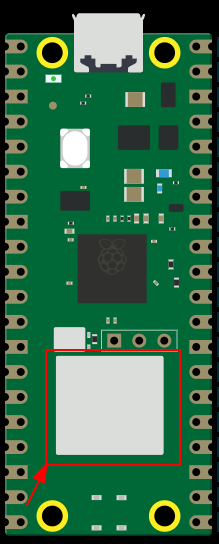
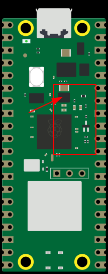

# Embedded Development for the Raspbaerry Pi Pico Using Rust

Writing embedded code using the Raspberry Pi Pico with the Rust ecosystem.

# Hardware

Before any code is written, first we need to be familar with the hardware. 
Firstly, know which board you are exactly using - my are pretty similar but there are some key differences that may trip you up, plus you'll need to 
know which one to target when building the binary, these are the following options:

- [Pico](https://pip-assets.raspberrypi.com/categories/610-raspberry-pi-pico/documents/RP-008307-DS-2-pico-datasheet.pdf)
- [Pico W](https://pip-assets.raspberrypi.com/categories/686-raspberry-pi-pico-w/documents/RP-008312-DS-2-pico-w-datasheet.pdf)
- [Pico 2](https://pip-assets.raspberrypi.com/categories/1005-raspberry-pi-pico-2/documents/RP-008299-DS-3-pico-2-datasheet.pdf)
- [Pico 2 W](https://pip-assets.raspberrypi.com/categories/1088-raspberry-pi-pico-2-w/documents/RP-008304-DS-3-pico-2-w-datasheet.pdf)

Firstly, [this site](https://picow.pinout.xyz/) is a great source for checking the differences between the board layouts.
Here are some of the easiest was to tell which is which by just looking at the board:

| Board Differentiation | Notes | Image |
| ----------- | ----------- | ----------- | 
| Wireless (W) vs Non-Wireless Series | The Pico W series will contain the [CYW43439](https://www.infineon.com/part/CYW43439) wireless chip, which is visible on the board. |  |
| 1st vs 2nd Edition | The Pico 2 will have this additional IC along this what a 3 pin transistor [(Q1)](https://pcbsync.com/pcb-tombstone-marking-guide/) that is visible. |  |

The main functionality difference between the wireless and non-wireless models is wifi / bluetooth support. From a programming standpoint the
wireless models requires firmware for the CYW43439 chip to enable certain functionality.

**Note:** The H in either Pico H or Pico WH just tells you whether the board has the headers soldered on or not. 

# Rust Embedded Frameworks

# Environment & Setup

# Sample Projects
